# Artifact 1.1: Wyoming Community College Commission (WCCC) New Program Request Form
### Associate of Applied Science (AAS) in Artificial Intelligence

> **Institution:** Laramie County Community College (LCCC)  
> **Submission Date:** March 21, 2024  
> **Program Implementation:** Fall Semester 2025  
> **CIP Code:** 11.0102 (*Artificial Intelligence and Robotics*)  
> **Funding Alignment:** Wyoming Innovation Partnership (WIP) Phase II Grant (Digital Information Technology Pillar)  
> **Credential Conferred:** Associate of Applied Science (AAS) in Artificial Intelligence (63–64 Total Credits)  
> **Source File:** `legacy/Project 1 Course Development/Artifacts/WCCC New Program Request Form AI_05202024.docx`  

---

## 1. Executive Summary & Labor Market Justification

The Associate of Applied Science (AAS) in Artificial Intelligence at LCCC was created in direct response to the **Wyoming Innovation Partnership (WIP) Phase II** initiative to prepare graduates for high-growth technical careers in the state. 

* **Workforce Preparation:** Prepares students for entry-level positions across healthcare analytics, government administration, logistics, energy systems, and software technology.
* **Statewide Uniqueness:** The first dedicated degree of its kind in Wyoming, designed with embedded general education, transition competencies (`HMDV 1510`), and direct workforce application.
* **Curricular Agility:** Built around 8 newly designed courses (24 credit hours of brand-new curriculum) while leveraging foundational computing and math courses.

---

## 2. Official Approved Curriculum (63–64 Credits)

### New Courses Created for the Degree (24 Total Credits)

| Course Prefix & Number | Course Title | Credits | Description / Level |
| :--- | :--- | :---: | :--- |
| **`AIML 1010`** | Introduction to Artificial Intelligence | 3 | Core overview, historical evolution, narrow vs. general AI |
| **`AIML 1020`** | Ethics in Artificial Intelligence | 3 | Bias, privacy, copyright, societal impact, governance |
| **`AIML 1030`** | Introduction to Machine Learning | 3 | Supervised/unsupervised algorithms, lifecycle, metrics |
| **`AIML 2030`** | Natural Language Processing | 3 | NLP models, feature engineering, text generation |
| **`AIML 2040`** | Artificial Intelligence for Computer Vision | 3 | Image processing, feature detection, OpenCV, vision models |
| **`AIML 2050`** | Artificial Intelligence for Business Solutions | 3 | Applied enterprise AI, workflows, business intelligence |
| **`AIML 2395`** | Artificial Intelligence Capstone | 3 | Real-world industry client project and oral/technical defense |
| **`COSC 2060`** | Data Engineering | 3 | Data ingestion, SQL, cloud warehousing, pipeline cleaning |

---

## 3. Semester-by-Semester Degree Sequence

```mermaid
flowchart TD
    subgraph Y1F ["Year 1: Fall Semester (17 Credits)"]
        Y1F1["AIML 1010: Intro to AI (3 cr)"]
        Y1F2["AIML 1020: AI Ethics (3 cr)"]
        Y1F3["STAT 2050: Fundamentals of Statistics (4 cr)"]
        Y1F4["COSC 1010: Intro to Computer Science (4 cr)"]
        Y1F5["STRT 1000: Strategies for Success (3 cr)"]
    end

    subgraph Y1S ["Year 1: Spring Semester (15 Credits)"]
        Y1S1["AIML 1030: Intro to Machine Learning (3 cr)"]
        Y1S2["CMAP 1815: Database Applications (3 cr)"]
        Y1S3["ENGL 1010: English Composition I (3 cr)"]
        Y1S4["MATH 1400 (College Alg) OR COSC 2409 (Python) (3 cr)"]
        Y1S5["Wyoming Statutory Requirement (HIST/POLS/ECON) (3 cr)"]
    end

    subgraph Y1Sum ["Year 1: Summer Term (0-3 Credits)"]
        Y1Sum1["Optional: MATH 1405 (Trigonometry) (3 cr)"]
    end

    subgraph Y2F ["Year 2: Fall Semester (13 Credits)"]
        Y2F1["AIML 2030: Natural Language Processing (3 cr)"]
        Y2F2["AIML 2040: AI for Computer Vision (3 cr)"]
        Y2F3["MATH 2200 (Calculus I) OR COSC 1030 (CS I) (4 cr)"]
        Y2F4["COMM 1015 (Foundations) OR COMM 2010 (Public Speaking) (3 cr)"]
    end

    subgraph Y2S ["Year 2: Spring Semester (15-16 Credits)"]
        Y2S1["AIML 2050: AI for Business Solutions (3 cr)"]
        Y2S2["AIML 2395: AI Capstone Project (3 cr)"]
        Y2S3["COSC 2060: Data Engineering (3 cr)"]
        Y2S4["HMDV 1510: Success in Workplace - Soft Skills (3 cr)"]
        Y2S5["MATH 2250 (Linear Algebra) OR COSC 2030 (CS II) (3-4 cr)"]
    end

    Y1F --> Y1S --> Y1Sum --> Y2F --> Y2S
```

### Detailed Semester Breakdown

* **Fall Semester 1st Year (17 Credits):**
  * `AIML 1010`: Introduction to Artificial Intelligence (3 cr)
  * `AIML 1020`: Ethics in Artificial Intelligence (3 cr)
  * `STAT 2050`: Fundamentals of Statistics (4 cr)
  * `COSC 1010`: Introduction to Computer Science (4 cr)
  * `STRT 1000`: Strategies for Success (3 cr)

* **Spring Semester 1st Year (15 Credits):**
  * `AIML 1030`: Introduction to Machine Learning (3 cr)
  * `CMAP 1815`: Database Applications (3 cr)
  * `ENGL 1010`: English Composition (3 cr)
  * `MATH 1400`: College Algebra OR `COSC 2409`: Programming (3 cr)
  * Wyoming Statutory Requirement (HIST 1211, HIST 1221, HIST 1251, POLS 1000, ECON 1200) (3 cr)

* **Summer Semester 1st Year (0–3 Credits):**
  * `MATH 1405`: Trigonometry (0–3 cr; choice point for students on advanced math track)

* **Fall Semester 2nd Year (13 Credits):**
  * `AIML 2030`: Natural Language Processing (3 cr)
  * `AIML 2040`: Artificial Intelligence for Computer Vision (3 cr)
  * `MATH 2200`: Calculus I OR `COSC 1030`: Computer Programming I (4 cr)
  * `COMM 1015`: Foundations of Communication OR `COMM 2010`: Public Speaking (3 cr)

* **Spring Semester 2nd Year (15–16 Credits):**
  * `AIML 2050`: Artificial Intelligence for Business Solutions (3 cr)
  * `AIML 2395`: Artificial Intelligence Capstone Project (3 cr)
  * `COSC 2060`: Data Engineering (3 cr)
  * `HMDV 1510`: Success in the Workplace - Soft Skills (3 cr)
  * `MATH 2250`: Introduction to Linear Algebra OR `COSC 2030`: Computer Programming II (3–4 cr)

**Total Proposed Program Credits:** 63 to 64 Credits.
