# Artifact 4.2: University of Wyoming (UW) School of Computing Articulation Crosswalk

> **Collaborating Institutions:** Laramie County Community College (LCCC) & University of Wyoming (UW)  
> **Participating Units:** LCCC STEM Pathway | UW School of Computing (SoC) | UW College of Engineering (CoE)  
> **Faculty Lead:** Trevor Swarm  
> **Target Programs:** UW B.S. in Applied Computing, UW B.S. in Computer Science, UW B.S. in Data Science  
> **Source Data:** `legacy/Project 1 Course Development/Artifacts/Artificial Intelligence AS Crosswalk.xlsx`  

---

## 1. Context & Purpose

A critical responsibility of two-year college technical faculty is ensuring that associate degree graduates have transparent, guaranteed transfer pathways to four-year universities. Working directly with leadership and faculty in the University of Wyoming School of Computing, I developed a comprehensive course-by-course articulation crosswalk.

This crosswalk verifies that students completing the LCCC Associate of Applied Science or Associate of Science in Artificial Intelligence enter UW with junior-level standing and zero duplicate coursework.

---

## 2. 2+2 Articulation Mapping (Sample Crosswalk Excerpt)

```mermaid
flowchart LR
    subgraph LCCC ["LCCC Foundation (63-64 Credits)"]
        L1["COSC 1010: Intro to CS"]
        L2["COSC 1030: CS I (C++)"]
        L3["COSC 2030: CS II (Data Structures)"]
        L4["COSC 2060: Data Engineering"]
        L5["AIML 1030: Intro to Machine Learning"]
        L6["MATH 1400 / 2200: Pre-Calc / Calc I"]
    end

    subgraph UW ["University of Wyoming Degree Pathways"]
        U1["B.S. in Applied Computing (SoC)"]
        U2["B.S. in Computer Science (CoE)"]
        U3["B.S. in Data Science (Interdisciplinary)"]
    end

    LCCC -->|Guaranteed Junior Standing| UW
```

### Direct Course Equivalencies

| LCCC Course & Number | UW Equivalent | Degree Application at UW |
| :--- | :--- | :--- |
| **`COSC 1010`** Intro to Computer Science | `COSC 1010` Intro to CS | Direct prerequisite satisfaction for all computing majors |
| **`COSC 1030`** Computer Science I (C++) | `COSC 1030` Computer Science I | Core major requirement in CoE and SoC |
| **`COSC 2030`** Computer Science II (Data Structures) | `COSC 2030` Computer Science II | Core major requirement in CoE and SoC |
| **`COSC 2060`** Data Engineering (SQL/PostgreSQL) | Upper-Division Tech Elective / Data Requirement | Applies toward Data Science / Applied Computing major cores |
| **`AIML 1010`** Intro to Artificial Intelligence | `COSC 1200` / Computing Elective | Technical elective fulfillment |
| **`AIML 1030`** Introduction to Machine Learning | `COSC 4450` Equivalent / Upper-Division Elective | Satisfies applied AI requirement in School of Computing |

---

## 3. Collaborative Significance

* **Statewide System Alignment:** Eliminates friction between Wyoming's largest community college and the state's sole four-year public research university.
* **Student Equity:** Allows Wyoming students to complete affordable foundational credits in Cheyenne before transferring smoothly to Laramie, reducing overall student debt.
