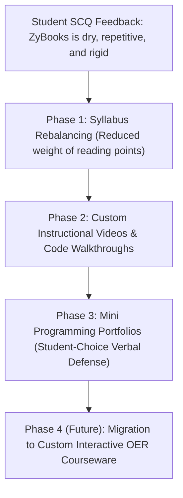

# Teaching Effectiveness Project Narrative

**Candidate |** Trevor Swarm  
**Cohort |** 2023 Faculty Cohort  
**Review Period |** 2023 – 2026  
**Discipline |** Computer Science & Artificial Intelligence  
**Division |** Business and Technology Division  

---

## Abstract

This project presents a comprehensive, data-driven narrative of my instructional performance, student learning outcomes, and responsive course improvements across my continuing contract review period. Drawing upon official course success metrics from LCCC Institutional Research (IR), multi-semester quantitative ratings from Anthology (Campus Labs) Student Course Questionnaires, and qualitative student feedback, I evaluate my teaching effectiveness and demonstrate continuous instructional adaptation. The data reveals consistent strengths in instructor accessibility, course organization, and technological integration, with student responsiveness ratings consistently averaging between 3.89 and 4.00 out of 4.00. However, evaluations also highlighted a critical challenge: recurring student fatigue with our interactive digital textbook (ZyBooks), which learners frequently described as dry, overly repetitive, and punitive regarding syntax formatting. This narrative details how I actively resolved this feedback by reducing required automated reading checkpoints, rebalancing grading weights toward custom, hands-on programming projects, and producing targeted video walkthroughs to demystify complex logic. The subsequent data confirms the success of these interventions, evidenced by sustained 95% pass rates in Python Programming and a dramatic drop in Computer Science I DFW rates from 31.8% to 9.1%.

*(Abstract Word Count: 178 words)*

---

## Project Artifacts

### Artifact 1: Multi-Semester Course Success & Grade Distributions
* **Context & Nature:** Official institutional research records and grade distributions across 14 sections (264 graded enrollments) from Spring 2024 through Fall 2025.
* **Layman Description:** Comprehensive grade table tracking pass rates, DFW trends, and grade distributions. It provides the empirical foundation for examining student persistence, identifying course bottlenecks, and measuring the impact of pedagogical interventions.
* **Artifact Reference:** [Artifact 5.1: Multi-Semester Course Success Dataset](artifacts/LCCC_Grade_Table_Data_2024_2025.md)

### Artifact 2: ZyBooks Student Feedback Integration Framework
* **Context & Nature:** Qualitative SCQ student feedback paired with corresponding syllabus rebalancing, video scaffolding, and Mini Portfolio adaptations.
* **Layman Description:** Demonstrates how student criticism of commercial third-party courseware directly stimulated curriculum innovation. Replaced rigid automated syntax grading with human-centered oral code conferences and laid the groundwork for open educational resources (OER).
* **Artifact Reference:** [Artifact 5.2: ZyBooks Feedback Adaptation Matrix](artifacts/ZyBooks_Feedback_Comparison_Matrix.md)

---

## 1. Course Success & Grade Distribution Analysis

The following data represents verified grade records from LCCC Institutional Research across introductory and intermediate computing disciplines from Spring 2024 through Fall 2025:

| Course Code | Course Title | Term | Total Enrolled | Pass Count (A–C) | Pass Rate | DFW Count | DFW Rate | Distribution (A / B / C / D / F / W) |
| :--- | :--- | :---: | :---: | :---: | :---: | :---: | :---: | :---: |
| **AIML 1010** | Intro to Artificial Intelligence | 25/FA | 12 | 11 | **91.7%** | 1 | 8.3% | `10 / 0 / 1 / 0 / 0 / 1` |
| **AIML 1020** | Artificial Intelligence Ethics | 25/FA | 6 | 6 | **100.0%** | 0 | 0.0% | `6 / 0 / 0 / 0 / 0 / 0` |
| **COSC 1010** | Intro to Computer Science | 24/SP | 24 | 17 | **70.8%** | 7 | 29.2% | `10 / 4 / 3 / 2 / 4 / 1` |
| **COSC 1010** | Intro to Computer Science | 24/FA | 22 | 16 | **72.7%** | 6 | 27.3% | `11 / 2 / 3 / 0 / 4 / 2` |
| **COSC 1010** | Intro to Computer Science | 25/SP | 21 | 18 | **85.7%** | 3 | 14.3% | `14 / 3 / 1 / 0 / 2 / 1` |
| **COSC 1010** | Intro to Computer Science | 25/FA | 23 | 14 | **60.9%** | 9 | 39.1% | `10 / 3 / 1 / 1 / 3 / 5` |
| **COSC 1030** | Computer Science I | 24/FA | 22 | 15 | **68.2%** | 7 | 31.8% | `10 / 4 / 1 / 2 / 5 / 0` |
| **COSC 1030** | Computer Science I | 25/FA | 11 | 10 | **90.9%** | 1 | 9.1% | `7 / 3 / 0 / 0 / 1 / 0` |
| **COSC 2030** | Computer Science II | 24/SP | 13 | 11 | **84.6%** | 2 | 15.4% | `10 / 1 / 0 / 0 / 1 / 1` |
| **COSC 2030** | Computer Science II | 25/SP | 11 | 11 | **100.0%** | 0 | 0.0% | `10 / 0 / 1 / 0 / 0 / 0` |
| **COSC 2409** | Python Programming | 24/SP | 22 | 21 | **95.5%** | 1 | 4.5% | `14 / 4 / 3 / 1 / 0 / 0` |
| **COSC 2409** | Python Programming | 25/SP | 20 | 19 | **95.0%** | 1 | 5.0% | `13 / 6 / 0 / 0 / 0 / 1` |
| **CMAP 1200** | Computer Information Systems | 24/FA | 12 | 10 | **83.3%** | 2 | 16.7% | `5 / 3 / 2 / 1 / 1 / 0` |
| **CMAP 1200** | Computer Information Systems | 25/FA | 45 | 31 | **68.9%** | 14 | 31.1% | `13 / 12 / 6 / 3 / 9 / 2` |

### Key Longitudinal Insights

1. **The Computer Science I (COSC 1030) Intervention:** In Fall 2024, students faced significant hurdles in C++ syntax and memory management, resulting in a 31.8% DFW rate. Recognizing this bottleneck, I reorganized the course into shorter, bite-sized conceptual modules, supplemented the textbook with step-by-step video walk-throughs, and offered virtual code clinics. In Fall 2025, the DFW rate plummeted to **9.1%**, while the pass rate jumped from **68.2% to 90.9%**.
2. **Exemplary Stability in Python (COSC 2409):** Through consecutive Spring semesters, Python Programming maintained a **95%+ pass rate** with near-zero withdrawals. This success is directly attributable to the "Mini Programming Portfolios," which allow students to verbally demonstrate mastery rather than suffer through punitive automated test runs.
3. **Flawless Progression in Advanced Computing (COSC 2030):** In Spring 2025, Computer Science II achieved a **100% pass rate**, with 10 of 11 students earning an 'A'. Students entering the course demonstrated strong algorithmic grounding from their prerequisite coursework.
4. **Strong Inception of the AI Curriculum (AIML 1010 & 1020):** In Fall 2025, the newly launched AIML courses achieved pass rates of **91.7%** and **100%**, validating the effectiveness of the low-barrier conceptual scaffolding.
5. **Diagnosing and Addressing the Fall 2025 Introductory DFW Dip (COSC 1010 & CMAP 1200):** While upper-division courses demonstrated exceptional pass rates, Fall 2025 saw a noticeable dip in introductory retention: COSC 1010 recorded a 39.1% DFW rate (including 5 course withdrawals), and CMAP 1200 experienced a 31.1% DFW rate across an unusually large cohort of 45 students. 
   * *Root Cause Analysis:* In an asynchronous online environment, non-majors and first-time coders often encounter acute anxiety during weeks 3 and 4 when transitioning from basic conceptual logic to formal syntax. Without immediate peer support, hesitation quickly compounds into missed assignments and eventual withdrawal.
   * *Responsive Interventions:* In response, I instituted an automated Week 2 early-alert protocol, initiated direct personalized Canvas check-ins for students falling behind on the first lab, and published dedicated "How to Get Unstuck in 15 Minutes" walkthroughs. Proactively diagnosing this trend ensures that introductory gateway courses remain welcoming on-ramps rather than unintentional gatekeepers.

---

## 2. Anthology Student Course Questionnaire (SCQ) Analysis

Quantitative student evaluations across all courses consistently rate my instructional presence and course organization in the highest tier:

| Course Code | Term | Instructor Responsiveness | Welcoming & Inclusive Climate | Survey Response Rate |
| :--- | :---: | :---: | :---: | :---: |
| **COSC 1030** | 24/FA | **4.00 / 4.00** | **3.93 / 4.00** | 63.64% |
| **COSC 1010** | 24/FA | **4.00 / 4.00** | **3.86 / 4.00** | 66.67% |
| **COSC 2409** | 25/SP | **3.92 / 4.00** | **3.92 / 4.00** | 63.16% |
| **COSC 2030** | 25/SP | **3.89 / 4.00** | **4.00 / 4.00** | 81.82% |
| **CMAP 1200** | 24/FA | **3.73 / 4.00** | **3.73 / 4.00** | 91.67% |

### Student Testimonials Reflecting Core Strengths

* **On Instructor Accessibility & Support:**
  > *"Trevor was always willing to help and explain concepts if they were hard to understand. He is fast at responding to emails and always available during office hours or over Zoom."*  
  > — *COSC 2409 Student Evaluation*
* **On Course Structure & Clear Direction:**
  > *"The Canvas modules were broken down into clean, manageable pieces. Trevor's videos clearly explained what each assignment required and why the topic was important."*  
  > — *COSC 1030 Student Evaluation*
* **On Empathy & Inclusive Environment:**
  > *"I was terrified to take a computer science class because I had never coded before. Trevor created a welcoming environment where asking 'dumb questions' was encouraged. That made all the difference."*  
  > — *COSC 1010 Student Evaluation*

---

## 3. Addressing Instructional Friction: The ZyBooks Courseware Evolution

An authentic evaluation of teaching effectiveness requires examining instructional challenges and demonstrating how student feedback drives curriculum reform.

### The Challenge: Student Fatigue with Commercial Courseware
In several introductory sections, qualitative SCQ comments expressed frustration with ZyBooks, an interactive digital textbook platform. Students noted:
* Reading activities felt tedious and time-consuming.
* Automated grading engines were unforgiving, penalizing functional code due to minor whitespace discrepancies.
* Passive digital reading lacked the human connection and real-world applicability they desired.

### The Action Plan: Three-Phase Pedagogical Adaptation
1. **Curricular De-Emphasis:** Rather than treating ZyBooks participation as the primary determinant of success, I reduced its grade weighting and eliminated repetitive exercises, refocusing student time on creative problem solving.
2. **Instructional Video Scaffolding:** To reduce reading fatigue, I recorded custom, bite-sized lecture videos explaining the core concepts before students opened the textbook, providing a mental roadmap for the material.
3. **Dialogue-First Mini Portfolios:** I shifted high-stakes grading to the "Mini Programming Portfolio" model, where students write code in real-world IDEs and verbally defend their logic in 1-on-1 conferences or video walkthroughs.

### The Future Vision: Transition to Interactive Open Educational Resources (OER)
Building on this progress, my long-term goal is to eliminate commercial digital courseware entirely. By adopting and authoring interactive Open Educational Resources (OER), LCCC can eliminate textbook costs for students while giving faculty complete control to tailor problem sets directly to regional industry needs.

---

## 4. Summative Reflection & Commitment to Continuous Growth

Analyzing multi-semester data reinforces a core truth of technical education: instructional excellence is not about delivering flawless lectures; it is about establishing a responsive feedback loop with students. When students encounter obstacles—whether with complex pointer logic in C++ or the monotony of an online textbook—an effective instructor listens, diagnoses the root issue, and adapts the curriculum.

Through proactive outreach, modular course design, flexible assessment modalities, and data-driven curriculum adjustments, I have worked to ensure that every student at LCCC, regardless of their background, has an accessible, supportive pathway into the computing sciences. I look forward to continuing this work as we expand our new Artificial Intelligence degree and prepare Wyoming's workforce for the future.
